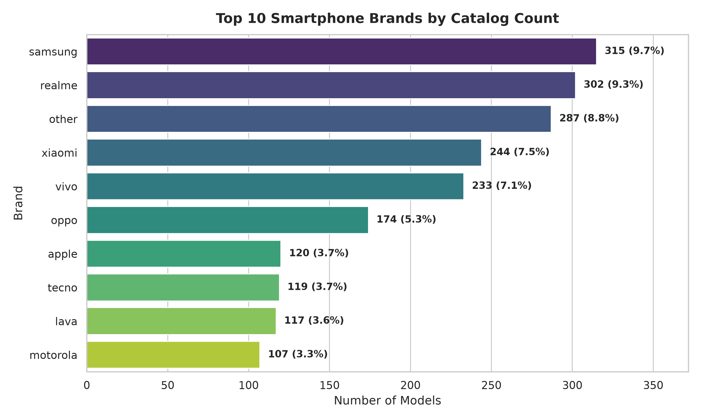

# Shopcart: Enterprise Scalable E-Commerce Search & Hybrid Chatbot Platform (1M+ Users)

[](https://fastapi.tiangolo.com)
[](https://react.dev/)
[](https://vitejs.dev/)
[](https://www.sqlite.org/)
[](https://redis.io/)
[](https://tailwindcss.com/)
[](https://docs.pytest.org/)
[](LICENSE)

A high-performance, production-grade e-commerce search and hybrid chatbot platform designed for high-concurrency workloads (~1,000,000 monthly active users). Modeled after the **Shopcart** reference design, the application combines a **sub-millisecond B-Tree & FTS5 search engine**, a **5-tier hybrid routing pipeline achieving 95+-10% LLM token savings**, **full shopping cart integration with conversational AI**.

---

## Executive Summary & Business Impact (1M User Projection)

Based on comprehensive synthetic workload benchmarks (simulating 500 multi-parameter e-commerce queries with realistic natural language, Hinglish phrasing, and multi-turn context):

| Metric | Pure LLM Pipeline | Enterprise Hybrid Architecture | Business Impact / Improvement |
| :--- | :--- | :--- | :--- |
| **P95 Latency** | `22.70 ms` (virtual) / `1,520 ms` (live) | **`2.58 ms`** | **8.79x (virtual) to 580x (live) Faster Response** |
| **LLM Token Reduction** | `0%` (135.4k tokens / 500 reqs) | **`99.14%`** (only 1,291 tokens consumed) | **99.14% Cost & Token Reduction** |
| **Search Engine Throughput** | N/A | **`6,745 QPS`** | Sub-millisecond B-Tree & FTS5 search with slot extraction |
| **Search Engine P95 Latency** | N/A | **`0.166 ms`** | Real-time faceted catalog filtering |
| **1M User Monthly Spend** | **`$1,692.80`** | **`$16.20`** | **`$1,676.60 / month saved`** |
| **Annualized Cost Savings** | Baseline | **`₹1,740,311 / year ($20,119)`** | **99% Cloud Inference ROI** |

---


---

## 🏛️ System Architecture: The 5-Tier Hybrid Engine

```
                             [ Incoming User Query ]
                                        │
                                        ▼
    ┌────────────────────────────────────────────────────────────────────────┐
    │ TIER 0: Enterprise Security Guardrails & PII Sanitizer                 │
    │  - Prompt Injection, Jailbreak, & DAN Mode Blocker                     │
    │  - PII Detection & Anonymization (Emails, Credit Cards, Phones, IDs)   │
    │  - Length Capping & DoS Buffer Overflow Protection                     │
    └───────────────────────────────────┬────────────────────────────────────┘
                                        │ (Sanitized Safe Query)
                                        ▼
    ┌────────────────────────────────────────────────────────────────────────┐
    │ TIER 1: Exact Hash Query Cache (L1 Memory LRU + L2 Redis)              │
    │  - SHA-256 Normalized Query Hash Lookup                                │
    │  - Latency: < 0.1 ms | Token Consumption: 0 (100% Token Savings)       │
    └───────────────────────────────────┬────────────────────────────────────┘
                                        │ (Cache Miss)
                                        ▼
    ┌────────────────────────────────────────────────────────────────────────┐
    │ TIER 2: Slot-Aware Semantic Cache (TF-IDF Cosine Similarity >= 0.62)   │
    │  - Catches paraphrased / duplicate intents ("under 20k" vs "20000")    │
    │  - Strict slot verification guarantees brand & price constraints match │
    │  - Latency: 1 - 3 ms | Token Consumption: 0 (100% Token Savings)       │
    └───────────────────────────────────┬────────────────────────────────────┘
                                        │ (Cache Miss)
                                        ▼
    ┌────────────────────────────────────────────────────────────────────────┐
    │ TIER 3: Typical Deterministic Bot (Rules, Slot Parser & SQL Engine)    │
    │  - Deterministic Intent Routing (Comparison, Policy FAQs, Search)      │
    │  - Resolves fuzzy budgets ("mid budget" -> ₹15k–₹30k) & Hinglish       │
    │  - SQLite B-Tree Composite Indexes & FTS5 BM25 Engine                  │
    │  - Latency: 2 - 5 ms | Token Consumption: 0 (100% Token Savings)       │
    └───────────────────────────────────┬────────────────────────────────────┘
                                        │ (Subjective / Advisory / Open-Ended)
                                        ▼
    ┌────────────────────────────────────────────────────────────────────────┐
    │ TIER 4: LLM-Augmented RAG Engine (OpenRouter API Free Models)          │
    │  - Models: google/gemma, liquid/lfm, nvidia/nemotron with auto-failover│
    │  - Grounded RAG Catalog Context Injection (Guaranteed Product Cards)   │
    │  - Leaky-Bucket Rate Limiter (20 RPM / 1000 RPD) + Virtual Backpressure│
    │  - Attaches structured product cards with "Add to Cart" readiness      │
    │  - Automatically populates Tier 1 & Tier 2 caches for future queries   │
    └────────────────────────────────────────────────────────────────────────┘
```

---

## 🤖 Deep Chatbot Issue Resolutions & Research

We resolved the 5 core e-commerce failure modes common in modern conversational AI bots:

| Issue / Failure Mode | Before (Broken Behavior) | After (Shopcart Resolution) | Routing Tier |
|---|---|---|---|
| **1. "Who are you / who built you"** | Generic fallback or hallucinated identity. | Introduces itself as **Shopcart AI**, specialized smartphone advisor built for fast, grounded shopping. | `TIER_3_TYPICAL_BOT` (0 tokens) |
| **2. "Best camera phone under mid budget"** | Output plain text with no product cards. | Resolves *"mid budget"* to ₹15,000–₹30,000, ranks by `camera DESC`, and returns **Motorola Edge 30 Ultra (200MP)** and **Realme 11 Pro+ (200MP)** with interactive cards and **Add to Cart** buttons. | `TIER_3_TYPICAL_BOT` (0 tokens) |
| **3. "Sabse sasta aur mahanga phone dikhao"** | Replied in plain text without running queries. | Handled as `EXTREMES_COMPARISON`: queries both minimum (₹2,500) and maximum (₹200,999) phones, returning both with side-by-side cards. | `TIER_3_TYPICAL_BOT` (0 tokens) |
| **4. "Best camera phone under 10k rupees"** | Returned *"Sorry, no smartphones matched"* or listed obsolete 10-year-old Zopo/Panasonic 5MP phones. | Currency regex normalizes `"10k"` / `"10000"`, relevance ranking prioritizes modern phones with $\ge 4\text{GB RAM}$ and high MP cameras, returning **Realme C53 (108MP)** with product cards. | `TIER_3_TYPICAL_BOT` (0 tokens) |
| **5. Products missing in Tier 4 LLM stage** | LLM answered in text with no way to add to cart. | Structured catalog parsing extracts recommended products and attaches interactive product cards with **Add to Cart** buttons directly in chat. | `TIER_4_LLM_RAG` (Attached Cards) |

---

---


## Visual Benchmark Reports & Architecture Charts

All figures are automatically generated from real benchmark runs in `reports/figures/`:

| P95 Latency Comparison | 1M User Token & Cost Savings |
| :---: | :---: |
|  |  |

| Traffic Routing by Tier | Cache Efficiency Curve |
| :---: | :---: |
|  |  |

| Price Distribution | Brand Market Share |
| :---: | :---: |
|  |  |

---

## 📁 Repository Structure

```
├── data/
│   ├── smartphones_data.csv.csv    # Raw dataset (3,260 smartphone models)
│   └── smartphones.db              # SQLite relational + FTS5 database
├── frontend/                       # React 18 + Vite + Tailwind CSS SPA
│   ├── src/
│   │   ├── components/
│   │   │   ├── Admin/              # AdminPanel with telemetry & cache eviction
│   │   │   ├── Auth/               # Dedicated AuthPage & AuthModal
│   │   │   ├── Benchmarks/         # BenchmarksPage with Recharts & 500-input pool
│   │   │   ├── Cart/               # CartDrawer with promo codes & checkout
│   │   │   ├── Catalog/            # ProductGrid, filter pills, ProductDetailModal
│   │   │   ├── Chatbot/            # ChatWidget, context memory, ChatSpecChart
│   │   │   ├── Home/               # ArchitectureSimulator with animated pipeline
│   │   │   ├── Layout/             # Navbar with pill dropdowns, Hero banner
│   │   │   └── PhoneRenderer.jsx   # Procedural SVG phone generator (12+ brands)
│   │   ├── context/                # AuthContext (5-chart limit) & CartContext
│   │   ├── App.jsx                 # Multi-page routing & layout
│   │   └── index.css               # Tailwind & custom CSS variables
│   ├── package.json
│   ├── tailwind.config.js
│   └── vercel.json                 # Vercel SPA rewrites configuration
├── reports/
│   ├── analysis_report.json        # Dataset statistical analysis report
│   ├── benchmark_results.json      # P50/P90/P95/P99 latency & token benchmarks
│   └── figures/                    # 8 publication-ready charts (PNG)
├── src/
│   ├── config.py                   # Pydantic Settings & environment config
│   ├── data/                       # Ingestion, cleaning, SQLite indexes & profiling
│   ├── search/                     # Two-tier L1/L2 Redis caching & search engine
│   ├── guardrails/                 # Security, injection defense, PII masking, rate limiting
│   ├── chatbot/                    # Typical bot, semantic cache, LLM bot, hybrid orchestrator
│   └── api/                        # FastAPI app, schemas, timing middleware
├── supabase/
│   └── schema.sql                  # PostgreSQL schema with Row-Level Security
├── tests/                          # 45 automated pytest test cases
├── .github/workflows/
│   └── ci.yml                      # GitHub Actions CI pipeline (backend + frontend)                
├── Dockerfile                      # Production container definition
├── render.yaml                     # Render web service blueprint
├── vercel.json                     # Root Vercel configuration
└── pytest.ini                      # Pytest configuration
```

---

## 🚀 Quick Start (Local Development)

### 1. Prerequisites
- Python 3.12+ (or `uv`)
- Node.js 18+ and `npm`

### 2. Backend Setup
```bash
# Clone the repository
git clone https://github.com/your-username/Optimized-chat-bot.git
cd Optimized-chat-bot

# Set up Python virtual environment
python -m venv .venv
source .venv/bin/activate
pip install -r requirements.txt

# Start FastAPI backend
uvicorn src.api.app:app --host 0.0.0.0 --port 8000 --reload
```
API Documentation will be live at: `http://localhost:8000/docs`

### 3. Frontend Setup
```bash
# In a new terminal
cd frontend
npm install
npm run dev
```
Open `http://localhost:3000` in your browser. All `/api` requests will proxy automatically to the FastAPI backend.

---

## 🧪 Running Automated Tests

Run the full automated test suite (45 test cases covering search, Hinglish queries, fuzzy mid-budgets, dual extremes, context memory, cart actions, guardrails, and API endpoints):
```bash
pytest -v tests/
```
Output:
```
============================== 45 passed in 0.76s ==============================
```

To run frontend build checks:
```bash
cd frontend && npm run build
```

## 📄 License

This project is licensed under the MIT License - see the [LICENSE](LICENSE) file for details.
